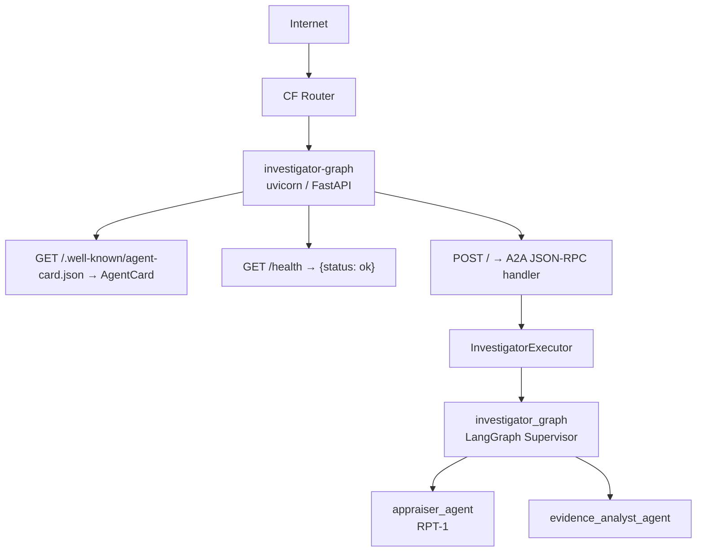

# Deploy Your Agent to Cloud Foundry with A2A

## Overview

Your investigator graph is working great locally. But right now, it only runs on your machine. In this exercise, you'll expose it as a **web service** that anyone (or any other agent) can call remotely, and deploy it to **SAP BTP Cloud Foundry**.

To do that, you'll use the **A2A protocol** (Agent-to-Agent), an open standard that lets AI agents communicate with each other over HTTP — regardless of which framework or platform they were built on.

By the end of this exercise, your investigator graph will be:

- ✅ Running as a persistent HTTP server
- ✅ Reachable via a public URL on SAP BTP
- ✅ Discoverable by other agents through the A2A standard

---

## Understand the A2A Protocol

### What is A2A?

**A2A (Agent-to-Agent)** is an open protocol, [originally developed by Google](https://a2a-protocol.org/latest/), that standardizes how AI agents communicate with each other over HTTP. Think of it as REST for agents.

| Concept | What it is | Example |
|---|---|---|
| **Agent Card** | A JSON document describing what an agent can do | "I can investigate art thefts" |
| **Skill** | A specific capability of an agent | `investigate` skill |
| **Task** | A unit of work sent to the agent | "Find the suspect" |
| **Event Queue** | Stream of status updates while the agent works | `working → completed` |

### Why A2A Matters

Without A2A, each agent framework speaks its own language. With A2A:

| Without A2A | With A2A |
|---|---|
| ❌ Agents are locked into one framework | ✅ Any agent can call any other agent |
| ❌ Custom integration code per tool/agent | ✅ Standard HTTP endpoints, discoverable by URL |
| ❌ No standard way to describe capabilities | ✅ Agent Card at `/.well-known/agent-card.json` |
| ❌ No standard way to report progress | ✅ Event-based task status updates (`working → completed`) |

---

## Create the Server

### Step 1: Create server.py

👉 Create a new file [`/project/Python-LangGraph/solution/server.py`](/project/Python-LangGraph/solution/server.py).

#### Part 1: Imports

```python
import asyncio
import json
import os

from a2a.server.agent_execution import AgentExecutor, RequestContext
from a2a.server.apps.jsonrpc import A2AFastAPIApplication
from a2a.server.events import EventQueue
from a2a.server.request_handlers import DefaultRequestHandler
from a2a.server.tasks import InMemoryTaskStore
from a2a.types import (
    Artifact,
    TaskState,
    TaskStatus,
    TaskStatusUpdateEvent,
    TaskArtifactUpdateEvent,
    TextPart,
    AgentCard,
    AgentCapabilities,
    AgentSkill,
)
from fastapi.middleware.cors import CORSMiddleware

from investigator_graph import investigator_graph
from payload import payload
```

> 💡 **What these imports do:**
>
> - `AgentExecutor` — Abstract base class you must implement. It defines `execute()` and `cancel()`, the two lifecycle methods of a task.
> - `RequestContext` — Carries the incoming task: the message from the caller, the task ID, and the context ID.
> - `EventQueue` — You push events into this queue to report progress back to the caller (`working`, `completed`, `canceled`).
> - `A2AFastAPIApplication` — Wires the A2A protocol on top of FastAPI. Handles routing, JSON-RPC encoding, and the Agent Card endpoint automatically.
> - `InMemoryTaskStore` — Stores task state in memory. Sufficient for a single-instance deployment.
> - `AgentCard`, `AgentSkill`, `AgentCapabilities` — The self-description of your agent, served at `/.well-known/agent-card.json`.
> - `HumanMessage` — Wraps the incoming request into the format LangGraph's graph expects.

#### Part 2: The Executor

This is the heart of the server — the class that actually runs your graph when a task arrives.

```python
class InvestigatorExecutor(AgentExecutor):
    async def execute(self, context: RequestContext, event_queue: EventQueue) -> None:
        # 1. Tell the caller we've started working
        await event_queue.enqueue_event(
            TaskStatusUpdateEvent(
                task_id=context.task_id,
                context_id=context.context_id,
                status=TaskStatus(state=TaskState.working),
                final=False,
            )
        )

        # 2. Parse the incoming message
        user_input = context.get_user_input()
        try:
            parsed = json.loads(user_input)
            user_request = parsed.get("user_request", user_input)
            suspect_names = parsed.get("suspect_names", user_input)
        except (json.JSONDecodeError, TypeError):
            user_request = user_input
            suspect_names = user_input

        # 3. Run the graph (blocking call, so we offload it to a thread)
        loop = asyncio.get_event_loop()
        result = await loop.run_in_executor(
            None,
            lambda: investigator_graph.invoke({
                "payload": payload,
                "suspect_names": suspect_names,
                "appraisal_result": None,
                "evidence_analysis": None,
                "final_conclusion": None,
                "messages": [],
            }),
        )

        final_text = result["final_conclusion"] or "Investigation completed but no conclusion was reached."

        # 4. Send the result back as an artifact
        await event_queue.enqueue_event(
            TaskArtifactUpdateEvent(
                task_id=context.task_id,
                context_id=context.context_id,
                artifact=Artifact(
                    artifactId="investigation_result",
                    parts=[TextPart(text=final_text)],
                    name="investigation_result",
                ),
            )
        )

        # 5. Mark the task as completed
        await event_queue.enqueue_event(
            TaskStatusUpdateEvent(
                task_id=context.task_id,
                context_id=context.context_id,
                status=TaskStatus(state=TaskState.completed),
                final=True,
            )
        )

    async def cancel(self, context: RequestContext, event_queue: EventQueue) -> None:
        await event_queue.enqueue_event(
            TaskStatusUpdateEvent(
                task_id=context.task_id,
                context_id=context.context_id,
                status=TaskStatus(state=TaskState.canceled),
                final=True,
            )
        )
```

> 💡 **Understanding the executor step by step:**
>
> **Step 1 — Signal `working`**
> The first thing you do is tell the caller the task has been received and is in progress. `final=False` means more events will follow.
>
> **Step 2 — Parse the input**
> The caller sends plain text or JSON. We try to parse it as JSON so we can extract structured fields like `suspect_names`. If it's not JSON, we use the raw string.
>
> **Step 3 — Run the graph in a thread**
> `investigator_graph.invoke()` is a **synchronous, blocking** call — LangGraph's invoke is not async-native. Calling it directly inside an `async` function would freeze the entire server. `run_in_executor` moves it to a thread pool, keeping the event loop free.
>
> The state passed to `invoke()` must include all required `AgentState` fields — `payload`, `suspect_names`, and the `None` placeholders for results the graph will fill in. The `user_request` parsed from the incoming message is not a state field; it is used only to set context via `suspect_names`.
>
> **Step 4 — Return the result as an artifact**
> The graph stores the Lead Detective's final report in `result["final_conclusion"]`. We wrap it in an `Artifact` and send it back to the caller.
>
> **Step 5 — Signal `completed`**
> `final=True` closes the task. The caller knows it can stop waiting.

#### Part 3: Resolve the App URL

```python
app_url = (
    lambda d: f"https://{d.get('application_uris', [])[0]}"
    if d.get("application_uris")
    else None
)(json.loads(os.environ.get("VCAP_APPLICATION", "{}")))
if not app_url:
    app_url = "http://localhost:8080"
```

> 💡 **How URL detection works:**
>
> Cloud Foundry injects a `VCAP_APPLICATION` environment variable containing a JSON object with metadata about the running app, including `application_uris` — the list of public routes assigned to it. When that variable is present, the first URI is used to build the `https://` URL. When running locally, `VCAP_APPLICATION` is absent, so `app_url` falls back to `http://localhost:8080`.

#### Part 4: The Agent Card and App Assembly

```python
agent_card = AgentCard(
    name="Investigator Graph",
    description="Multi-agent art theft investigation graph exposed as an A2A server",
    url=app_url,
    version="1.0.0",
    capabilities=AgentCapabilities(streaming=False),
    skills=[
        AgentSkill(
            id="investigate",
            name="Investigate Art Theft",
            description="Investigates art theft cases by appraising losses and analyzing evidence",
            tags=["investigation", "art", "insurance", "theft"],
            inputModes=["text/plain"],
            outputModes=["text/markdown"],
        )
    ],
    defaultInputModes=["text/plain"],
    defaultOutputModes=["text/markdown"],
)

handler = DefaultRequestHandler(
    agent_executor=InvestigatorExecutor(),
    task_store=InMemoryTaskStore(),
)
app = A2AFastAPIApplication(agent_card=agent_card, http_handler=handler).build()

app.add_middleware(
    CORSMiddleware,
    allow_origins=["*"],
    allow_methods=["*"],
    allow_headers=["*"],
)


@app.get("/health")
def health():
    return {"status": "ok"}


if __name__ == "__main__":
    import uvicorn
    uvicorn.run(app, host="0.0.0.0", port=int(os.environ.get("PORT", 8080)))
```

> 💡 **Understanding the Agent Card:**
>
> The `AgentCard` is the agent's public identity. When another agent or client calls `GET /.well-known/agent-card.json` on your server, it receives this document. It describes:
> - **What the agent is** (`name`, `description`, `version`)
> - **Where it lives** (`url` — automatically set from `VCAP_APPLICATION` when deployed to CF, falls back to `localhost` otherwise)
> - **What it can do** (`skills`) — each skill has an ID, description, and declared input/output formats
> - **Whether it streams** (`capabilities.streaming=False`) — we return results all at once, not as a stream
>
> **The `/health` endpoint** is required by Cloud Foundry to verify the app started successfully. CF polls it after deployment — if it doesn't return `200 OK`, the deployment fails.

---

## Update requirements.txt

👉 Create a new file [`/project/Python-LangGraph/solution/requirements.txt`](/project/Python-LangGraph/solution/requirements.txt) with the following:

```
# A2A SDK with HTTP server support
a2a-sdk[http-server]==0.3.25
# ASGI server for running the FastAPI app
uvicorn[standard]
# LangGraph multi-agent framework
langgraph
# LangGraph supervisor pattern
langgraph-supervisor
# LangChain core (tools, messages)
langchain-core
# LiteLLM integration for LangChain
langchain-litellm
# LLM interaction with SAP Generative AI Hub
litellm
# Environment configuration
python-dotenv
# Data validation
pydantic
# HTTP client
httpx
# HTTP requests
requests
# SAP AI Core SDK for integration with SAP Generative AI Hub
sap-ai-sdk-base==3.4.0
sap-ai-sdk-core==3.3.0
sap-ai-sdk-gen==6.7.0
```

---

## Create the Deployment Manifest

Cloud Foundry uses a `manifest.yml` file to know how to run your application. It tells CF how much memory to allocate, which buildpack to use, what command to start the app with, and which services to bind.

### Step 1: Create manifest.yml

👉 Create a new file [`/project/Python-LangGraph/solution/manifest.yml`](/project/Python-LangGraph/solution/manifest.yml) at the root of your project.

> 💡 Replace `<YOUR TEAM NAME>` in the `name` field with your own identifier (lowercase, no spaces) — your app's URL is derived from it.

```yaml
applications:
  - name: investigator-graph-<YOUR TEAM NAME>
    memory: 1024M
    disk_quota: 2048M
    instances: 1
    buildpacks:
      - https://github.com/cloudfoundry/python-buildpack/releases/download/v1.8.43/python-buildpack-cflinuxfs4-v1.8.43.zip
    health-check-type: http
    health-check-http-endpoint: /health
    timeout: 180
    command: python -m uvicorn server:app --host 0.0.0.0 --port $PORT --workers 1
    env:
      LITELLM_PROVIDER: sap
      AICORE_RESOURCE_GROUP: default
      AICORE_AUTH_URL: https://aws-sap-hackathon-si4ykj9d.authentication.ap10.hana.ondemand.com/oauth/token
      AICORE_BASE_URL: https://api.ai.prod.ap-southeast-2.aws.ml.hana.ondemand.com
      BP_PYTHON_VERSION: "3.13.11"
```

> 💡 This hackathon does **not** use a bound CF service. The non-secret settings above live in the manifest; your team's `AICORE_CLIENT_ID` and `AICORE_CLIENT_SECRET` (from the keybroker) are provided separately with `cf set-env` in the deploy step below — so they never get committed to git.

> 💡 **Understanding each field:**
>
> | Field | Purpose |
> |---|---|
> | `name` | The app name in CF. Your URL will be based on this. |
> | `memory` | RAM allocated per instance. 1GB is enough for uvicorn + LangGraph. |
> | `disk_quota` | Disk space for the app and its dependencies. 2GB covers all Python packages. |
> | `instances` | Number of app instances. Keep at 1 for this exercise. |
> | `buildpacks` | CF uses this to detect Python and install dependencies from `requirements.txt`. We pin a specific version to ensure reproducibility. |
> | `health-check-type: http` | CF checks the `/health` endpoint after startup to confirm the app is ready. |
> | `health-check-http-endpoint` | The path CF polls. Must return `200 OK`. |
> | `timeout` | How many seconds CF waits for the health check to pass before failing the deployment. 180s gives the app time to install packages. |
> | `command` | The startup command. `$PORT` is injected by CF — your app must listen on this port. |
> | `env` | Static environment variables. The secret `AICORE_CLIENT_ID`/`AICORE_CLIENT_SECRET` are added via `cf set-env`, not here. The app URL is detected automatically from `VCAP_APPLICATION` at runtime. |

> 💡 **Why `--workers 1`?**
> LangGraph invokes multiple LLM calls and external APIs per investigation. With limited memory (1024M), multiple concurrent graph runs would exhaust available RAM. One worker keeps resource usage predictable and safe.

### Step 2: Create runtime.txt

👉 Create a new file [`/project/Python-LangGraph/solution/runtime.txt`](/project/Python-LangGraph/solution/runtime.txt):

```
python-3.13.x
```

> 💡 The `x` is a wildcard — CF picks the latest patch version of Python 3.13.

---

## Protect Secrets with .cfignore

Your local `.env` file contains API keys and credentials. You must not push it to CF — on CF the credentials are provided as environment variables via `cf set-env` instead.

👉 Create a new file [`/project/Python-LangGraph/solution/.cfignore`](/project/Python-LangGraph/solution/.cfignore):

```
.env
.venv/
__pycache__/
*.pyc
*.pyo
.python-version
```

> ⚠️ **Important**: `.cfignore` works like `.gitignore` but for `cf push`. Files listed here are excluded from the upload to CF. Always include `.env` here to prevent accidentally uploading credentials.

---

## Deploy to Cloud Foundry

### Step 1: Log in to CF

Install the Cloud Foundry CLI v8 first:

```text
https://docs.cloudfoundry.org/cf-cli/install-go-cli.html
```

Log in:

```bash
cf login -a https://api.cf.ap10.hana.ondemand.com --sso
```

When prompted:

1. Choose the alternate/custom identity provider option.
2. Enter this origin key exactly:

```text
auisywroy-platform
```

3. Open the passcode URL printed by the CLI.
4. Sign in with your IAS email and password.
5. Paste the one-time passcode back into the terminal.

Target your org and team space:

```bash
cf target -o "SEAIO_aws-sap-hackathon-si4ykj9d" -s "hackathon-<your-team>"
```

If a command fails with an expired-token message, run `cf login --sso` again.

### Step 2: Push the App

👉 Navigate to your solution folder in the terminal:

```bash
cd project/Python-LangGraph/solution
```

👉 Make sure the `name` in `manifest.yml` ends with your own identifier. Push the app **without starting it** so you can set your credentials first:

```bash
cf push --no-start
```

> 💡 You can also override the manifest name directly: `cf push 'investigator-graph-<YOUR TEAM NAME>' --no-start`.

👉 Set your team's SAP AI Core credentials (from the keybroker) as environment variables. These are **not** in the manifest, so they never get committed to git:

```bash
cf set-env investigator-graph-<YOUR TEAM NAME> AICORE_CLIENT_ID '<clientid>'
cf set-env investigator-graph-<YOUR TEAM NAME> AICORE_CLIENT_SECRET '<clientsecret>'
```

> ⚠️ Single-quote the values — the keybroker `clientid` and `clientsecret` contain `!`, `|`, `$`, and `=` characters that the shell would otherwise interpret.

👉 Start the app:

```bash
cf start investigator-graph-<YOUR TEAM NAME>
```

CF will:
1. Upload your project files (excluding anything in `.cfignore`)
2. Detect Python and install dependencies from `requirements.txt`
3. Start the app with the `command` from `manifest.yml`
4. Poll `/health` until it returns `200 OK`

> ⚠️ **The first push can take a few minutes** — CF is downloading and installing all Python packages. Subsequent pushes are faster.

### Step 3: Get Your App URL

Once the push succeeds, CF prints the app URL:

```
name:              investigator-graph-<YOUR TEAM NAME>
requested state:   started
routes:            investigator-graph-<YOUR TEAM NAME>-<random>.cfapps.ap10.hana.ondemand.com (NOTE: THIS IS YOUR APP URL!!)
```

---

## Verify the Deployment

### Check the Agent Card

👉 Open a browser or run:

```bash
curl https://<YOUR_APP_URL>/.well-known/agent-card.json
```

You should see your agent's description:

```json
{
  "name": "Investigator Graph",
  "description": "Multi-agent art theft investigation graph exposed as an A2A server",
  "url": "https://investigator-graph-<YOUR TEAM NAME>-<random>.cfapps.ap10.hana.ondemand.com",
  "version": "1.0.0",
  "skills": [...]
}
```

### Check the Health Endpoint

```bash
curl https://<YOUR_APP_URL>/health
```

Expected response: `{"status": "ok"}`

### Check Your Agent in the A2A Editor

👉 Open the [A2A Editor](https://open-resource-discovery.github.io/a2a-editor/playground/)

👉 Add your agent by pasting the URL: `https://<YOUR_APP_URL>/.well-known/agent-card.json`

👉 Open the Chat and paste:

```json
{
    "user_request": "Investigate the art theft at the museum",
    "suspect_names": "Sophie Dubois, Marcus Chen, Viktor Petrov"
}
```

### Check the Logs

If you'd like to view the logs live as you query your agent:
```bash
cf logs investigator-graph-<YOUR TEAM NAME>
```

and the logs would then follow suit.

If something went wrong during startup:

```bash
cf logs investigator-graph-<YOUR TEAM NAME> --recent
```

---

## Understanding What Just Happened

### The Full Architecture

You now have a live, publicly reachable multi-agent system:



### How CF Manages Your App

| CF Feature | What it does for you |
|---|---|
| **Buildpack** | Detects Python, installs `requirements.txt`, sets up the runtime |
| **Health Check** | Restarts the app if `/health` stops responding |
| **Router** | Terminates TLS and routes HTTPS traffic to your app on `$PORT` |
| **Env vars** (`cf set-env` + manifest) | Provide the `AICORE_*` credentials to the app, read at runtime via `os.environ.get(...)` — no `.env` file needed |

---

## Key Takeaways

- **A2A** is an open protocol that lets agents communicate over HTTP regardless of framework
- **`AgentExecutor`** is the single class you implement — it bridges A2A tasks to your LangGraph graph
- **`run_in_executor`** is essential: `investigator_graph.invoke()` is synchronous, so you must offload it to a thread to keep the async server responsive
- **`result["final_conclusion"]`** extracts the Lead Detective's final report from the graph's state
- **`manifest.yml`** is the single source of truth for deployment — memory, buildpack, command, environment variables
- **`.cfignore`** prevents sensitive files (`.env`) from being uploaded to CF
- **`VCAP_APPLICATION`** provides the public URL at runtime — the Agent Card picks it up automatically

---

## Next Steps

1. ✅ [Set up your development space](01-setup-dev-space.md)
2. ✅ [Deploy your agent to CF with A2A](02-deploy-agent-to-cf.md) (this exercise)
3. ⬜ [Integrate your agent into SAP Joule](03-integrate-agent-into-joule.md)

---

## Troubleshooting

**Issue**: `cf push` fails with `health check failed`

- **Solution**: Check `cf logs investigator-graph-<YOUR TEAM NAME> --recent`. Common causes:
  - Missing `requirements.txt` dependency
  - Import error in `server.py` or `investigator_graph.py`
  - Missing credentials — verify `AICORE_CLIENT_ID` / `AICORE_CLIENT_SECRET` were set with `cf set-env` and the app was restarted (`cf restage` or `cf restart`)

**Issue**: `ModuleNotFoundError: No module named 'a2a'`

- **Solution**: Ensure `a2a-sdk[http-server]` is in `requirements.txt`. The square brackets are important — they install optional HTTP server dependencies.

**Issue**: `/.well-known/agent-card.json` returns a wrong URL

- **Solution**: The app URL is detected automatically from `VCAP_APPLICATION` at runtime. Run `cf apps` to verify the route, then check `cf logs investigator-graph-<YOUR TEAM NAME> --recent` for errors.

**Issue**: App crashes immediately after startup

- **Solution**: Check `cf logs investigator-graph-<YOUR TEAM NAME> --recent` for `KeyError` or `AttributeError`. Verify the `env:` values in `manifest.yml` are set and that `AICORE_CLIENT_ID` / `AICORE_CLIENT_SECRET` were provided via `cf set-env`.

**Issue**: `.env` was accidentally uploaded and credentials are exposed

- **Solution**: Add `.env` to `.cfignore`, run `cf push` to overwrite, then rotate your API credentials immediately in SAP BTP.

**Issue**: `Error: relation between task and context not found` when calling the agent

- **Solution**: The app likely restarted and lost its in-memory task state. Ensure `--workers 1` is in your `command` and check `cf logs investigator-graph-<YOUR TEAM NAME> --recent` for unexpected restarts.

---

## Resources

- [A2A Protocol Specification](https://a2a-protocol.org/latest/)
- [a2a-sdk Python package](https://pypi.org/project/a2a-sdk/)
- [SAP BTP Cloud Foundry deployment guide](https://help.sap.com/docs/btp/sap-business-technology-platform/deploy-application)
- [CF Python Buildpack releases](https://github.com/cloudfoundry/python-buildpack/releases)
- [LangGraph Documentation](https://langchain-ai.github.io/langgraph/)